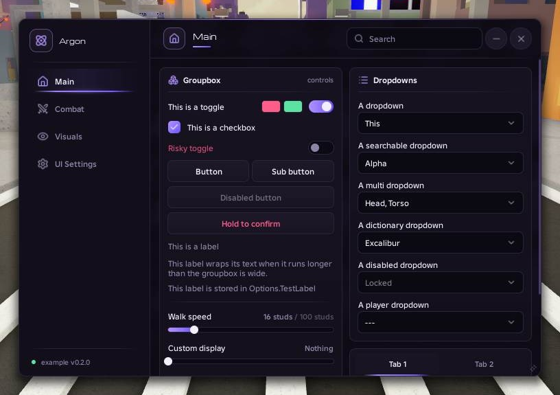
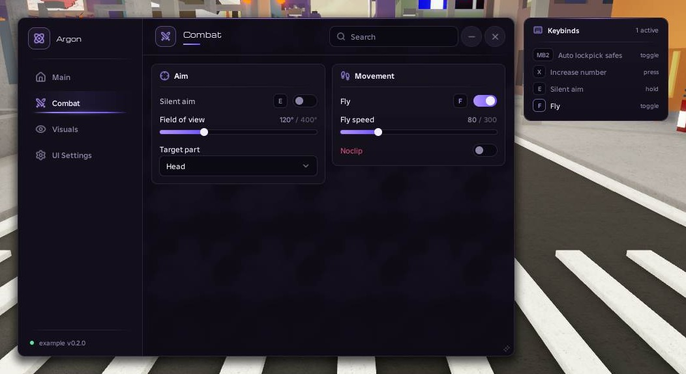
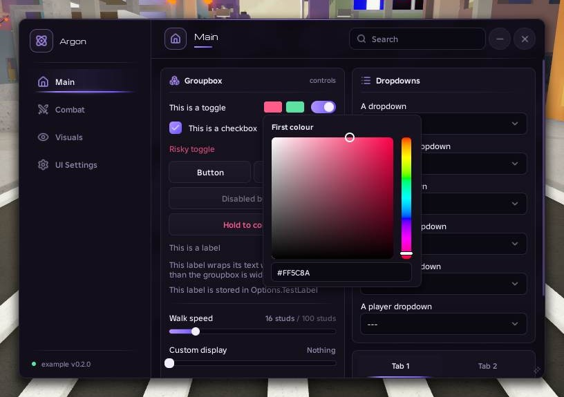
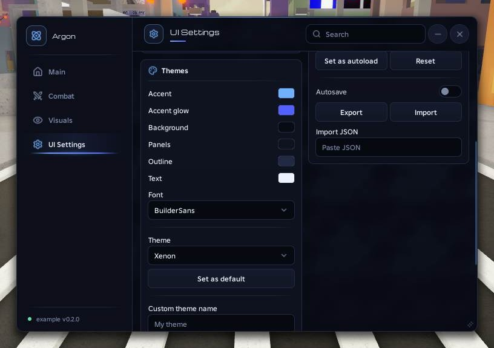
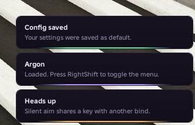

# Argon

A clean, dark UI library for Roblox script hubs. It uses the same API as
[Obsidian](https://github.com/deividcomsono/Obsidian), so most Obsidian scripts work after
swapping the loadstring links.



| | |
|---|---|
|  |  |
|  |  |

## Getting started

```lua
local repo = "https://raw.githubusercontent.com/YOUR_NAME/Argon/main/"

local Library = loadstring(game:HttpGet(repo .. "Library.lua"))()
local ThemeManager = loadstring(game:HttpGet(repo .. "addons/ThemeManager.lua"))()
local SaveManager = loadstring(game:HttpGet(repo .. "addons/SaveManager.lua"))()

local Window = Library:CreateWindow({ Title = "My Hub", Footer = "v1.0", Icon = "atom" })
local Main = Window:AddTab("Main", "house")

local Player = Main:AddLeftGroupbox("Player", "user")
Player:AddToggle("Fly", { Text = "Fly", Default = false })
Player:AddSlider("Speed", { Text = "Walk speed", Default = 16, Min = 0, Max = 100 })

Library.Toggles.Fly:OnChanged(function(on)
    print("Fly is now", on)
end)
```

`Example.lua` builds every control and both addons, so it's the quickest way to see
everything working.

## Window and tabs

```lua
local Window = Library:CreateWindow({
    Title = "My Hub",          -- shown in the sidebar
    Footer = "v1.0",           -- small text at the bottom of the sidebar
    Icon = "atom",             -- icon next to the title
    NotifySide = "Right",      -- where notifications appear: "Left" or "Right"
})

local Main = Window:AddTab("Main", "house")   -- name, icon
Window:SelectTab("Main")
```

Each tab has a left and a right column. Put controls in groupboxes:

```lua
local Box = Main:AddLeftGroupbox("Player", "user")
local Other = Main:AddRightGroupbox("World", "globe")
```

A tabbox is a groupbox with tabs along its top. Each of its tabs works like a groupbox:

```lua
local Tabbox = Main:AddRightTabbox()
local First = Tabbox:AddTab("First")
local Second = Tabbox:AddTab("Second")
```

## Controls

Every control takes an id. You read and change it later through `Library.Toggles[id]`
(toggles and checkboxes) or `Library.Options[id]` (everything else).

### Toggle and checkbox

```lua
Box:AddToggle("Fly", { Text = "Fly", Default = false, Tooltip = "Lets you fly" })
Box:AddCheckbox("Notify", { Text = "Notify me", Default = true })
```

Add `Risky = true` to colour the label red.

### Button

```lua
Box:AddButton({ Text = "Rejoin", Func = function() end })
Box:AddButton({ Text = "Reset", Func = reset, DoubleClick = true })     -- click twice to confirm
Box:AddButton({ Text = "Unload", Func = unload, HoldToConfirm = 1 })   -- hold for 1 second
```

`AddButton` returns the button, so `:AddButton({...})` on it adds a second one beside it.

### Slider

```lua
Box:AddSlider("Speed", { Text = "Walk speed", Default = 16, Min = 0, Max = 100, Rounding = 0, Suffix = " studs" })
```

Click the value to type an exact number.

### Input

```lua
Box:AddInput("Name", { Text = "Name", Placeholder = "Type here", Numeric = false })
```

### Dropdown

```lua
Box:AddDropdown("Part", { Text = "Target part", Values = { "Head", "Torso" }, Default = 1 })
Box:AddDropdown("Parts", { Text = "Parts", Values = { "Head", "Torso", "Legs" }, Multi = true })
Box:AddDropdown("Player", { Text = "Player", SpecialType = "Player", ExcludeLocalPlayer = true })
```

Add `Searchable = true` for a search box at the top of the list.

### Label and divider

```lua
Box:AddLabel("Some text")
Box:AddLabel("A longer line that wraps", true)
Box:AddDivider()
```

### Key picker and colour picker

These attach to a toggle or a label:

```lua
Box:AddToggle("Aim", { Text = "Aim" })
    :AddKeyPicker("AimKey", { Default = "E", Mode = "Hold", SyncToggleState = true })
    :AddColorPicker("AimColor", { Default = Color3.fromRGB(255, 90, 140) })

Box:AddLabel("Menu key"):AddKeyPicker("MenuKey", { Default = "RightShift", NoUI = true })
```

Key picker modes are `Toggle`, `Hold`, `Always` and `Press`. Right-click a picker to change
its mode, clear it or reset it.

## Reading and changing values

```lua
Library.Toggles.Fly.Value                    -- true or false
Library.Options.Speed:SetValue(50)

Library.Options.Speed:OnChanged(function(value)
    print("Speed is", value)
end)

Library.Options.AimKey:GetState()            -- is the bind active right now?
```

Toggles, sliders, inputs and dropdowns also have `SetText` and `SetDisabled`.

## Notifications

```lua
Library:Notify({ Title = "Saved", Description = "Your config was saved.", Time = 4, Type = "Success" })
```

`Type` can be `Info`, `Success`, `Warn` or `Error`. Hover a notification to pause it, and
click it to close it.

## Menu key and unloading

```lua
Library.ToggleKeybind = Library.Options.MenuKey   -- or an Enum.KeyCode; RightShift by default

Library:OnUnload(function()
    print("Unloaded")
end)
Library:Unload()
```

## Themes and configs

```lua
ThemeManager:SetLibrary(Library)
SaveManager:SetLibrary(Library)

ThemeManager:SetFolder("MyHub")
SaveManager:SetFolder("MyHub/configs")
SaveManager:IgnoreThemeSettings()

local Settings = Window:AddTab("Settings", "settings")
ThemeManager:ApplyToTab(Settings)
SaveManager:BuildConfigSection(Settings)
SaveManager:LoadAutoloadConfig()
```

ThemeManager comes with six themes (Argon, Neon, Krypton, Xenon, Helium and Radon), lets
users edit every colour and pick from all Roblox fonts, and saves custom themes.
SaveManager creates, loads, overwrites and deletes configs, can autoload and autosave one,
and can export a config to the clipboard and import it again.

## Icons

Anywhere that takes an icon accepts a name from the list below, a Roblox asset id or an
image URL.

activity, aperture, app-window, atom, backpack, ban, bell, bolt, bot, box, boxes, car,
check, chevron-down, chevron-left, chevron-right, chevron-up, chevrons-up-down,
circle-check, circle-dot, circle-question-mark, circle-x, clock, cloud, code, coins,
copy, crosshair, crown, download, ellipsis, external-link, eye, eye-off, fish, flag,
flame, folder, footprints, gamepad-2, gauge, ghost, gift, globe, grip-vertical, hand,
hash, heart, house, image, info, key, keyboard, layers, layout-grid, link, list, lock,
lock-open, magnet, mail, map, maximize-2, message-circle, minimize-2, minus, moon,
mouse, mouse-pointer-2, mouse-pointer-click, move, orbit, package, paintbrush, palette,
panel-left, pencil, pickaxe, pin, plane, plus, power, radar, radio, refresh-cw, rocket,
rotate-ccw, save, scan, scroll-text, search, send, settings, shield, shopping-cart,
skull, sliders-horizontal, sliders-vertical, sparkle, sparkles, square-check, star,
sun, sword, swords, target, terminal, timer, toggle-right, trash, triangle-alert,
trophy, upload, user, users, wand-sparkles, wifi, wrench, x, zap

## Credits

Icons from [Lucide](https://lucide.dev), ISC License (see `assets/LUCIDE_LICENSE`). API
shape after Obsidian and LinoriaLib.
